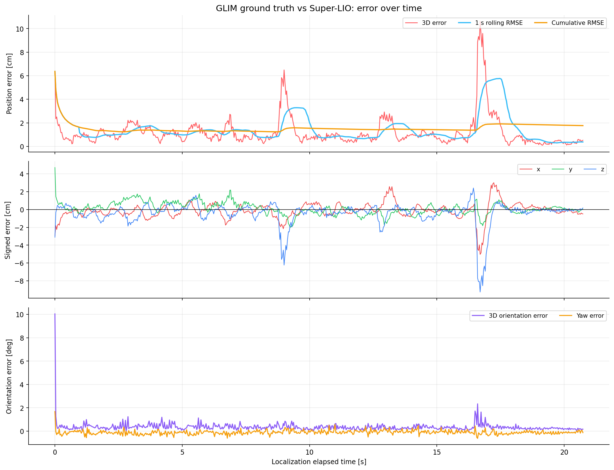
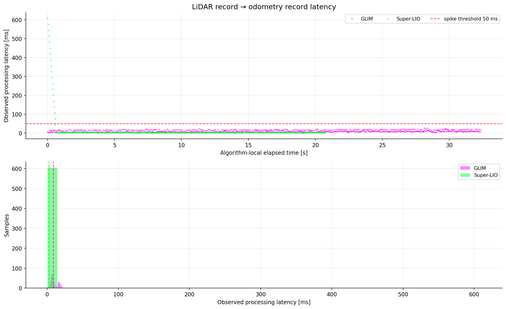
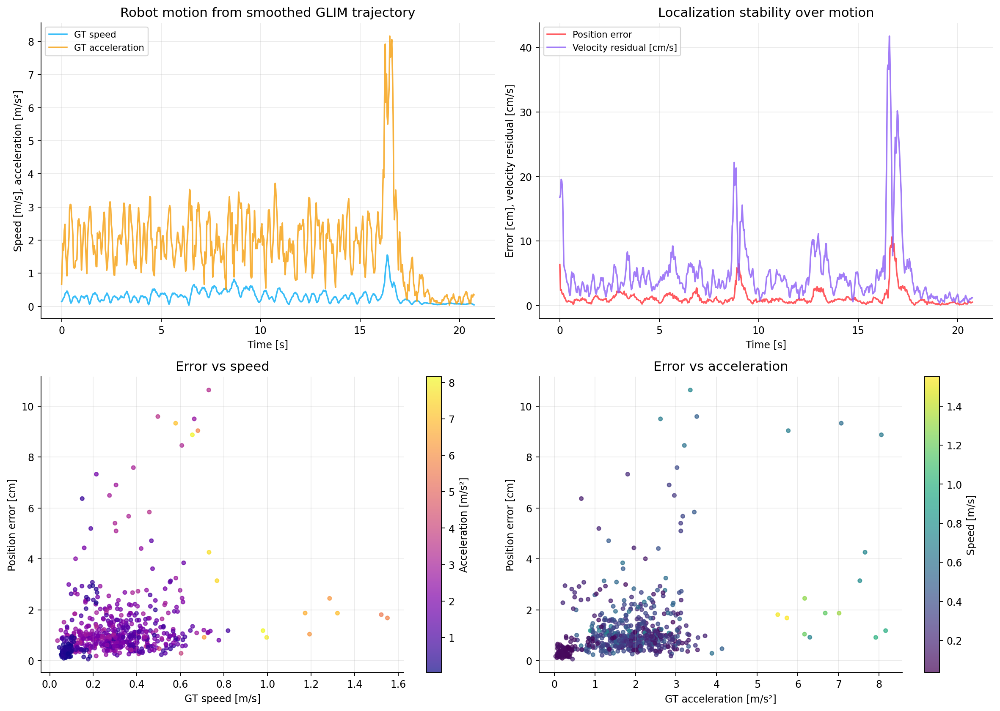
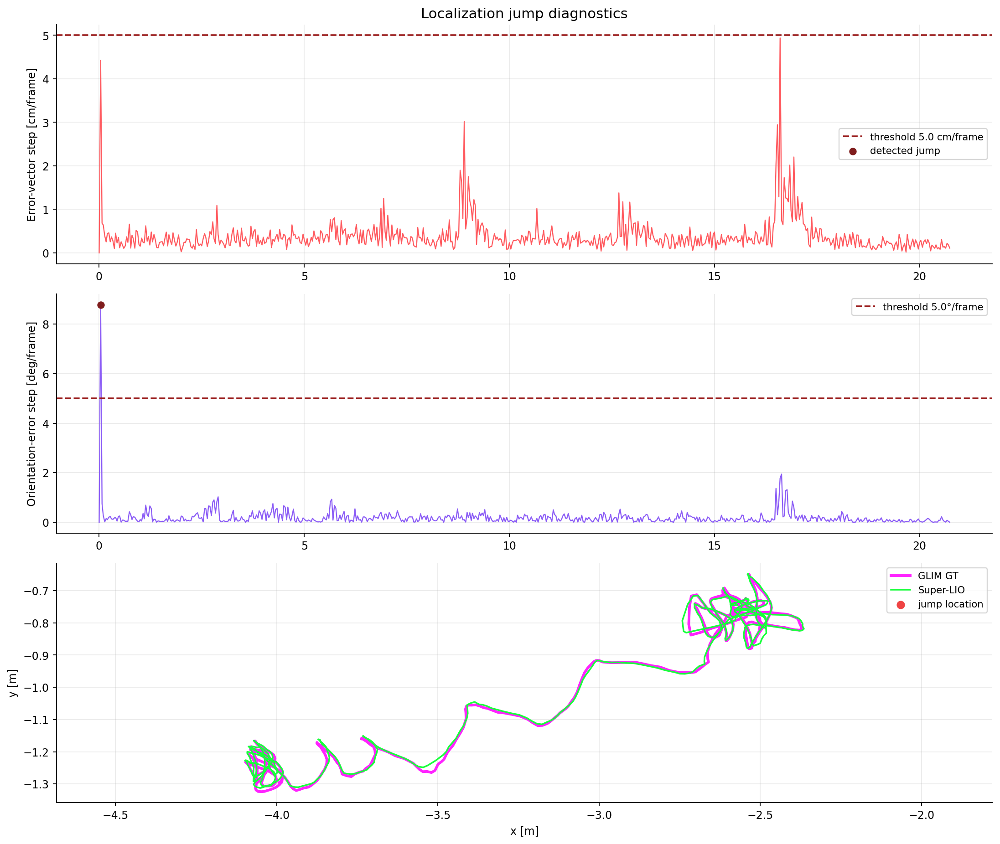
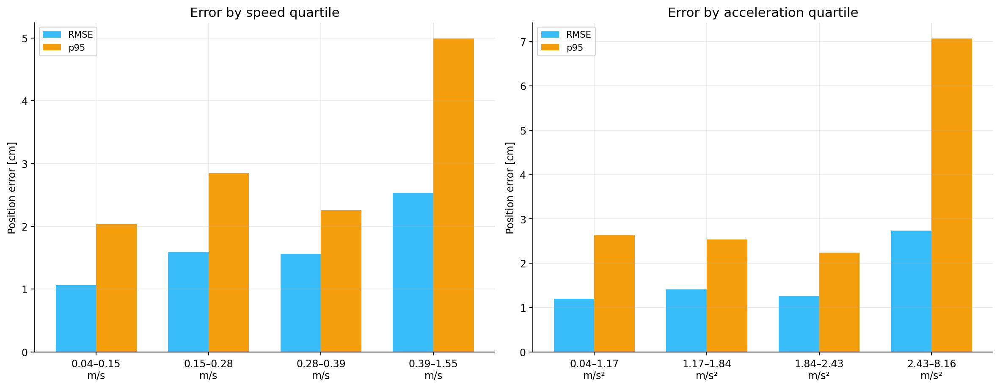

# GLIM vs Super-LIO quantitative report

## 핵심 결과

- 비교 구간: **20.74 s**, 동기 pose **623개**
- 3D 위치오차: RMSE **1.77 cm**, 평균 **1.20 cm**, p95 **2.93 cm**, 최대 **10.63 cm**
- 자세오차: 평균 **0.36°**, p95 **0.71°**, 최대 **10.05°**
- 관측 processing latency: GLIM median/p95/max **8.74/19.57/27.17 ms**, Super-LIO **2.65/6.01/608.95 ms**
- 위치 jump(>5.0 cm/frame): **0회**
- 자세 jump(>5.0°/frame): **1회**
- 위치오차 5.0 cm 초과 episode: **3회**
- Super-LIO latency 50 ms 초과: **18회**
- 속도-오차 상관계수 Pearson/Spearman: **+0.264 / +0.357**
- 가속도-오차 상관계수 Pearson/Spearman: **+0.358 / +0.360**

## 방법

- GLIM을 ground truth로 가정했습니다.
- 전체 궤적 최적 정렬 없이, prebuilt-map bag과 GLIM bag의 동일 센서 시각 pose 한 쌍으로 구한 고정 `T_map_glim`만 적용했습니다.
- 오차 계산은 원래 sensor `header.stamp`로 동기화했으며 fitted time offset은 사용하지 않았습니다.
- latency는 같은 bag 안에서 LiDAR scan 기록 시각부터 odometry 출력 기록 시각까지의 관측값입니다. ROS executor/recorder scheduling이 일부 포함됩니다.
- Super-LIO bag에 섞인 재생 원본 `/lio/odom` 869개는 제외했습니다.

## 그래프

