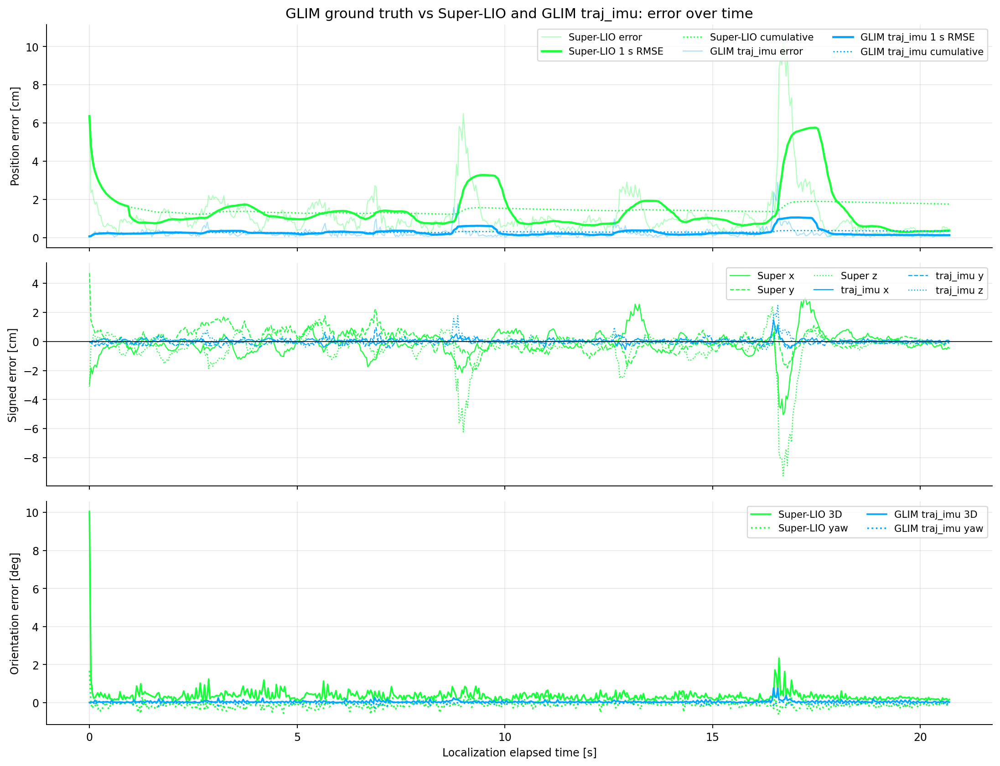
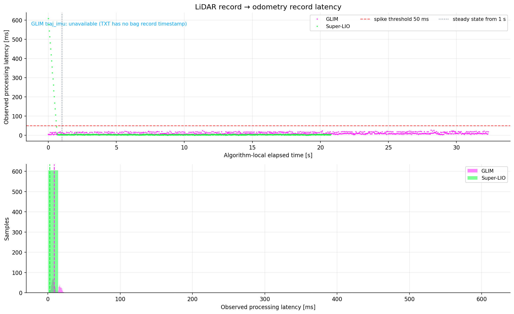
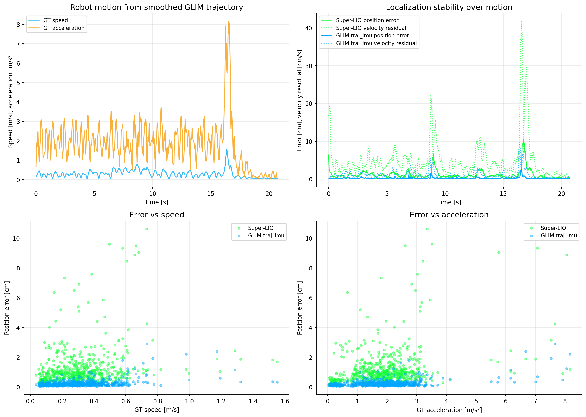
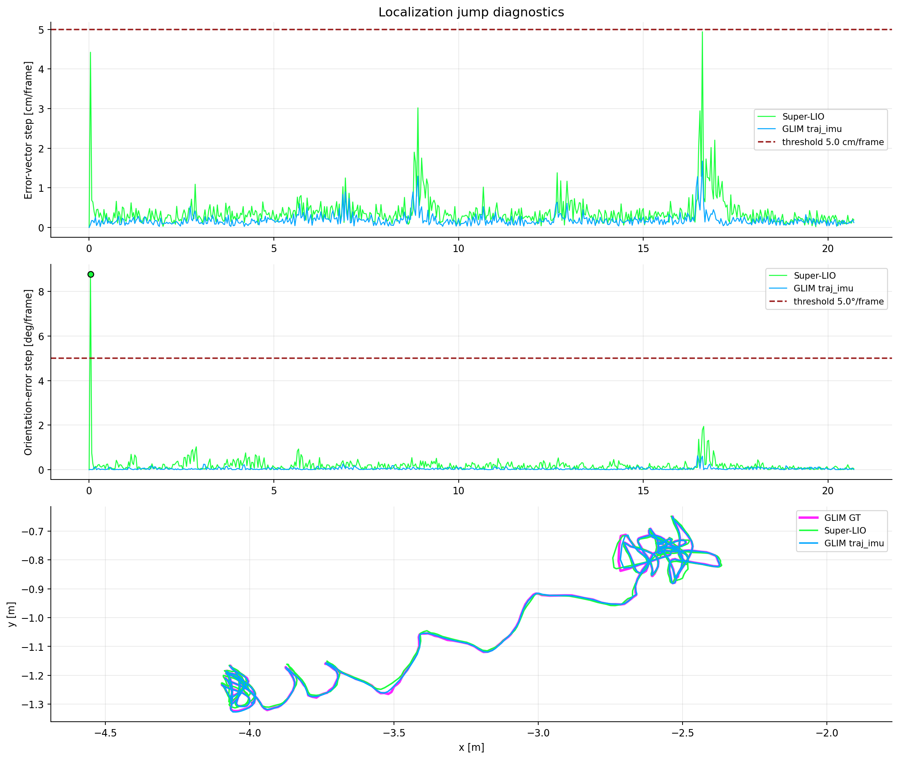
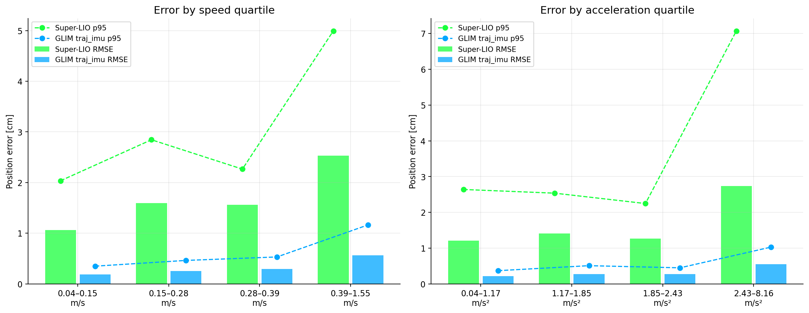

# Three-trajectory quantitative report

## 핵심 결과

- 비교 구간: **20.70 s**, 동기 pose **622개**
- Super-LIO 위치오차 RMSE/p95/max: **1.77/2.93/10.63 cm**
- GLIM `traj_imu` 위치오차 RMSE/p95/max: **0.35/0.58/2.90 cm**
- Super-LIO 자세오차 mean/p95/max: **0.36/0.71/10.05°**
- GLIM `traj_imu` 자세오차 mean/p95/max: **0.05/0.14/0.77°**
- 관측 processing latency: GLIM median/p95/max **8.74/19.57/27.17 ms**, Super-LIO **2.65/6.01/608.95 ms**
- Super-LIO 정상 주행(1.0 s 이후) latency median/p95/max **2.60/5.71/13.91 ms**
- 위치 jump(>5.0 cm/frame): Super-LIO **0회**, `traj_imu` **0회**
- 자세 jump(>5.0°/frame): Super-LIO **1회**, `traj_imu` **0회**
- 위치오차 5.0 cm 초과 episode: Super-LIO **3회**, `traj_imu` **0회**
- Super-LIO latency 50 ms 초과: 초기화 **18회**, 정상 주행 **0회**
- 속도-오차 Pearson/Spearman: Super-LIO **+0.264 / +0.355**, `traj_imu` **+0.423 / +0.312**
- 가속도-오차 Pearson/Spearman: Super-LIO **+0.358 / +0.358**, `traj_imu` **+0.489 / +0.248**

## 방법

- GLIM을 ground truth로 가정했습니다.
- 전체 궤적 최적 정렬 없이, prebuilt-map bag과 GLIM bag의 동일 센서 시각 pose 한 쌍으로 구한 고정 `T_map_glim`을 GLIM GT와 `traj_imu`에 똑같이 적용했습니다.
- 세 trajectory 모두 원래 sensor timestamp로 동기화했으며 fitted time offset은 사용하지 않았습니다.
- latency는 같은 bag 안에서 LiDAR scan 기록 시각부터 odometry 출력 기록 시각까지의 관측값입니다. ROS executor/recorder scheduling이 일부 포함됩니다.
- `traj_imu.txt`에는 bag record timestamp가 없어 latency는 계산할 수 없습니다.
- Super-LIO bag에 섞인 재생 원본 `/lio/odom` 869개는 제외했습니다.

## 그래프

